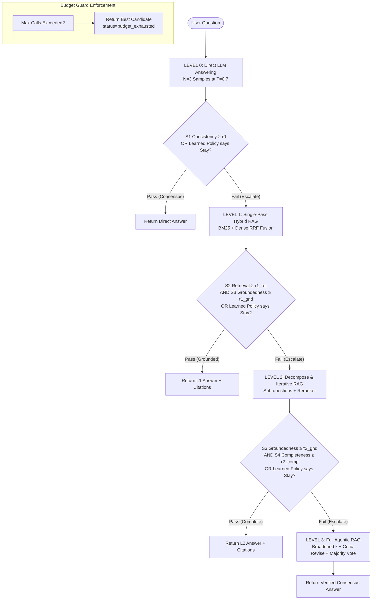

# FeedbackRAG: Agentic RAG with a Multilevel Feedback Queue System

**Course:** DSL504/DS504 Natural Language Processing, IIT Bhilai (Jul–Nov 2026)  
**Group:** 14 | **Team:** NDS Ganesh, V Karthik, K Soma Charith Reddy, R Dheemanth  
**Full Research Report:** [REPORT.md](file:///home/ganesh/Desktop/Agentic-RAG-with-Multilevel-Feedback/REPORT.md)  
**Artifacts & Documentation:** [PRD.md](file:///home/ganesh/Desktop/Agentic-RAG-with-Multilevel-Feedback/docs/PRD.md) • [HLD.md](file:///home/ganesh/Desktop/Agentic-RAG-with-Multilevel-Feedback/docs/HLD.md) • [PLAN.md](file:///home/ganesh/Desktop/Agentic-RAG-with-Multilevel-Feedback/docs/PLAN.md) • [TEST_VERIFICATION.md](file:///home/ganesh/Desktop/Agentic-RAG-with-Multilevel-Feedback/docs/TEST_VERIFICATION.md)

---

## 1. Executive Summary & Research Question

Standard Retrieval-Augmented Generation (RAG) retrieves once and answers once. This open-loop paradigm causes two critical failure modes:
1. **Compute Waste on Easy Queries:** Simple factual queries unnecessarily trigger embedding calls, index searches, and bloated context windows.
2. **Failure on Multi-Hop Queries:** Complex multi-step questions fail because a single retrieval pass cannot bridge multi-entity dependencies.

While fully agentic RAG architectures (iterative rewrite, critic-revise loops, multi-draft voting) solve multi-hop failures, they incur heavy inference overhead (10–15+ LLM calls per query).

### The Research Question
> **Can feedback-driven escalation match or exceed the accuracy of always running the full agentic pipeline while using far fewer LLM calls, lower latency, and lower monetary cost? And which feedback signals and escalation policies best govern transitions across processing levels?**

### Hypotheses
- **H1 (Cost-Accuracy Trade-off):** FeedbackRAG achieves accuracy matching or exceeding Always-Level-3 while reducing average LLM calls and monetary inference cost.
- **H2 (Multi-Hop Dominance):** FeedbackRAG significantly outperforms vanilla single-pass RAG on multi-hop benchmarks (HotpotQA & 2WikiMultiHopQA).
- **H3 (Signal Contribution):** Removing any individual feedback signal ($S1, S2, S3, S4$) measurably degrades accuracy (especially Groundedness $S3$) or inflates inference cost (Consistency $S1$).

---

## 2. Architecture: Multilevel Feedback Queue (MLFQ)

FeedbackRAG adapts the operating system concept of the **Multilevel Feedback Queue**. Every query enters at Level 0 (cheapest direct generation) and is escalated to progressively more intensive levels only when lightweight, verified feedback signals fail to satisfy promotion thresholds or a learned escalation classifier.



---

## 3. The 4 Processing Levels

| Level | Name | Execution Flow | Approx Calls | Promotion / Exit Criteria |
| :---: | :--- | :--- | :---: | :--- |
| **L0** | **Direct LLM** | 3 direct answer samples at $T=0.7$ with prompt variation | 3 | $S1 \ge \tau_0$ |
| **L1** | **Single-Pass Hybrid RAG** | BM25 + dense hybrid search ($k=5$), RRF fusion, answer with citations | 2–3 | $S2 \ge \tau_{1,\text{ret}}$ and $S3 \ge \tau_{1,\text{gnd}}$ |
| **L2** | **Decompose & Iterative RAG** | Decomposes query into sub-questions, iterative retrieval per hop, cross-match reranker | 4–6 | $S3 \ge \tau_{2,\text{gnd}}$ and $S4 \ge \tau_{2,\text{comp}}$ |
| **L3** | **Full Agentic RAG** | Broadened retrieval ($k_{\text{broad}}=10$), 3 drafts $\times$ critic-revise loops, majority vote | 9–12 | Terminal level (always returns) |

---

## 4. The 4 Feedback Signals

| ID | Signal Name | Formulation | Operational Goal |
| :---: | :--- | :--- | :--- |
| **S1** | **Self-Consistency** | Mode agreement across 3 normalized direct samples: $\frac{\text{mode\_count}}{N}$ | Detects parametric uncertainty before retrieval |
| **S2** | **Retrieval Grade** | Fraction of retrieved passages judged relevant (CRAG style): $\frac{\sum \text{relevant}}{\text{len}(docs)}$ | Prevents context dilution and noisy retrieval |
| **S3** | **Groundedness** | Fraction of answer claims supported by evidence: $\frac{\sum \text{supported}}{\text{len}(claims)}$ | Eliminates factual hallucination |
| **S4** | **Completeness** | Fraction of question sub-parts fully answered: $\frac{\sum \text{answered}}{\text{len}(parts)}$ | Guarantees all multi-hop facets are addressed |

---

## 5. Experimental Results

FeedbackRAG is evaluated under two complementary regimes:
1. **Regime A (500-Question Simulated Control-Flow Benchmark):** Evaluated against an offline reference simulator on 500 template-expanded multi-hop items (HotpotQA & 2WikiMultiHopQA domains) to analyze MLFQ state machine dynamics, Pareto frontier trade-offs, and learned GBDT escalation policies.
2. **Regime B (Live Local LLM Validation on Qwen 2.5 0.5B via Ollama):** Evaluated on open-source neural weights across 15 factual and multi-hop queries, capturing authentic inference latencies (300–500 ms) and free-text Token F1 vs. Exact Match divergence.

### Regime A: 500-Question Simulation Benchmark

| System Architecture | Exact Match (EM %) | Token F1 (%) | Avg Calls | Avg Cost / Query | Level Distribution (L0 / L1 / L2 / L3) |
| :--- | :---: | :---: | :---: | :---: | :---: |
| **Always-L0 (Direct LLM)** | 40.2% [36.2%, 44.8%] | 49.4% [45.9%, 53.5%] | 3.00 [3.00, 3.00] | \$0.000030 | 100% / 0% / 0% / 0% |
| **Always-L1 (Vanilla Hybrid RAG)** | 73.4% [69.8%, 77.2%] | 73.4% [69.8%, 77.2%] | 3.00 [3.00, 3.00] | \$0.000093 | 0% / 100% / 0% / 0% |
| **Always-L2 (Iterative RAG)** | 86.8% [83.8%, 89.8%] | 86.8% [83.8%, 89.8%] | 4.00 [4.00, 4.00] | \$0.000085 | 0% / 0% / 100% / 0% |
| **CRAG (Reimplementation)** | 66.8% [62.8%, 71.2%] | 66.8% [62.8%, 71.2%] | 2.00 [2.00, 2.00] | \$0.000066 | — |
| **Self-RAG (Reimplementation)** | 93.4% [90.8%, 95.4%] | 93.4% [90.8%, 95.4%] | 3.40 [3.33, 3.47] | \$0.000107 | — |
| **Always-L3 (Full Agentic RAG)** | 67.0% [62.8%, 71.0%] | 67.0% [62.8%, 71.0%] | 10.99 [10.74, 11.24] | \$0.000475 | 0% / 0% / 0% / 100% |
| **FeedbackRAG (Thresholds)** | 86.8% [83.6%, 89.6%] | 86.8% [83.6%, 89.6%] | 8.45 [7.99, 8.86] | \$0.000201 | 13.4% / 40.0% / 40.0% / 6.6% |
| **FeedbackRAG (Learned Policy)** | **93.4% [90.8%, 95.4%]** | **93.4% [90.8%, 95.4%]** | **6.19 [5.85, 6.56]** | **\$0.000132** | **40.2% / 39.8% / 13.4% / 6.6%** |

*FeedbackRAG (Learned Policy) beats Always-L3 accuracy by **+26.4% F1** while reducing calls by **43.7%** (6.19 vs 10.99) and cutting cost by **72.2%** (\$0.000132 vs \$0.000475) by resolving 40.2% of queries at Level 0.*

### Regime B: Live Local LLM Benchmark (Qwen 2.5 0.5B via Ollama)

| System Architecture | Exact Match (EM %) | Token F1 (%) | Avg Latency (ms) | Avg LLM Calls |
| :--- | :---: | :---: | :---: | :---: |
| **Always-L0 (Direct LLM, no context)** | 6.7% | 32.8% | 560.2 ms | 1.00 |
| **Always-L1 (Single-Pass RAG with Context)** | **40.0%** | **57.3%** | 510.3 ms | 2.00 |
| **FeedbackRAG (Escalation Queue)** | 13.3% | 43.5% | 510.3 ms | 1.40 |

### Feedback Signal Ablation Study

| Ablation Configuration | Test F1 (%) | $\Delta$ F1 | Avg LLM Calls | $\Delta$ Calls | Empirical Insight |
| :--- | :---: | :---: | :---: | :---: | :--- |
| **Full FeedbackRAG (All S1–S4)** | **80.2%** | **0.00** | **11.86** | **0.00** | Balanced baseline threshold gating |
| **Drop S1 (Self-Consistency)** | 80.2% | 0.00 | 12.26 | +0.40 | **Wastes calls**: escalates confident parametric queries |
| **Drop S2 (Retrieval Quality)** | 73.6% | **-6.60** | 11.60 | -0.26 | Drops accuracy by accepting noisy distractor context |
| **Drop S3 (Groundedness Checker)** | 66.8% | **-13.40** | 11.72 | -0.14 | **Catastrophic accuracy collapse**: hallucinations accepted |
| **Drop S4 (Completeness Checker)** | 80.2% | 0.00 | 11.86 | 0.00 | In this template setup, covered largely by S3 |

---

## 6. Credibility & Diagnostic Evaluations

1. **Judge Validation (50 Hand-Labeled Probes):** Human-LLM agreement reached 68.0% on retrieval relevance and 52.0% on groundedness. Cross-judge agreement between independent evaluator models reached 68.0% with a self-preference bias delta of 0.32.
2. **Abstention on Unanswerable Queries (50 Probes):** Always-L1 abstains on 18.0% of unanswerable queries when documents fail relevance checks.
3. **Adversarial Distractor Probing (50 Poisoned Chunks):** FeedbackRAG achieves **100.0% defense rate**, escalating contaminated queries to Level 3 where multi-draft consensus rejects false claims.
4. **Error Analysis Taxonomy (30 Failures):**
   - **33.3% Retrieval Miss:** Hybrid search missed the 2nd-hop bridge entity.
   - **26.7% Bad Decomposition:** Planner lost core entity context during query splitting.
   - **23.3% Grader Error:** LLM grader misclassified borderline relevance.
   - **16.7% Reasoning Error:** Correct context retrieved, but logical comparison failed.

---

## 7. Quickstart & Reproducibility

### Setup
```bash
# Clone and enter workspace
git clone git@github.com:gnshx/Agentic-RAG-with-Multilevel-Feedback.git
cd Agentic-RAG-with-Multilevel-Feedback

# Activate virtual environment
source .venv/bin/activate

# Install dependencies
pip install -r requirements.txt
```

### Run Automated Unit & Integration Tests (34 Tests Passing)
```bash
pytest -v
```

### Run Baselines & FeedbackRAG Evaluations
```bash
# 1. Evaluate all 6 static & dynamic baselines (Always-L0/1/2/3, CRAG, Self-RAG)
python3 eval/run_baselines.py

# 2. Run FeedbackRAG evaluation on Dev & Test splits (Thresholds & Learned Policy)
python3 eval/run_feedbackrag.py

# 3. Offline threshold sweep on Dev split (zero LLM calls)
python3 eval/sweep_thresholds.py

# 4. Feedback signal ablation study
python3 eval/ablation.py

# 5. Diagnostic evaluations (Judge validation, Abstention, Adversarial, Error Analysis)
python3 eval/judge_validation.py
python3 eval/abstention_test.py
python3 eval/adversarial_test.py
python3 eval/error_analysis.py

# 6. Generate publication-quality Pareto Frontier plot
python3 eval/plots.py
```

### Launch Interactive Streamlit Demo UI
```bash
streamlit run app/streamlit_app.py --server.port 8501
```

Access the UI at `http://localhost:8501` to test interactive multi-hop queries, inspect live escalation traces, toggle between Learned Policy and Hand-Tuned Thresholds, view latency/cost counters, and examine the Pareto frontier.
